<p align="center">
  
</p>

# luci-app-netbird

**English** | [简体中文](README.zh-cn.md)

**Fork:** this repository retains manual-binary support and configurable GitHub API/CDN mirrors. The binary-source selector offers official releases and custom URLs; the system `netbird` package is not a hard dependency. Install fork packages from [this fork's releases](https://github.com/InoriHimea/luci-app-netbird/releases), or build from source. The one-click feed below distributes the upstream variant, not this fork.

> [!NOTE]
> Upstream author's note: almost all of the code in this project was written through vibe coding. Upstream releases are tested on real devices running different OpenWrt versions, and the upstream author runs the app on more than 10 devices. This fork documents its own verification and rollout scope in the release notes.

LuCI app for the [NetBird](https://netbird.io) mesh-VPN client on OpenWrt / ImmortalWrt — manage NetBird on OpenWrt from the router, no command line needed.
Compatible with OpenWrt / ImmortalWrt 22.03 / 23.05 / 24.x (`opkg`) and 25.x / current snapshots (`apk`).
OpenWrt 21.02 and older cannot be supported — their package feeds lack `ucode` / `rpcd-mod-ucode`, which the backend runs on.

## Features

Surfaces the NetBird client's capabilities in the LuCI UI:

- Connect / reconnect / disconnect / deregister; self-hosted management
- Automatic reconnect after transient outages — with clear authentication-failure reasons
- Binary version management — official release or custom URL, with configurable GitHub API/CDN mirrors
- Opt-in nightly agent upgrades with persistent rollback, identity protection and a five-minute health gate
- Firewall automation — NetBird zone and LAN ↔ mesh forwarding
- Exit node selection — route all internet traffic through a mesh peer, switch or turn off in one click
- Full `netbird up` settings — WireGuard, routes, DNS, SSH, IPv6, Rosenpass, log level
- Peer status and live logs

## Install

**One-click** — adds the signed package feed, then installs the app:

```sh
# with curl:
sh -c "$(curl -fsSL https://luci-app-netbird.okk.sh/install.sh)"
# routers without curl:
wget -O - https://luci-app-netbird.okk.sh/install.sh | sh
```

Afterwards manage it normally — `opkg`/`apk` on the command line, or **LuCI → System → Software**. The package is architecture-independent (`PKGARCH:=all`); open it at **Services → NetBird**.

<details><summary><b>Add the feed only, then install yourself</b></summary>

```sh
wget -O - https://luci-app-netbird.okk.sh/feed.sh | sh
opkg install luci-app-netbird
# or:  apk add luci-app-netbird
```
</details>

<details><summary><b>Install from package files</b></summary>

Runtime deps (usually present): `rpcd`, `rpcd-mod-ucode`, `ucode`, `ucode-mod-fs`, `ucode-mod-uci`, `luci-base`, `conntrack`. An existing NetBird daemon service (`/etc/init.d/netbird`) is required; a manually installed binary is supported without the system `netbird` package.

```sh
# OpenWrt / ImmortalWrt 22.03 / 23.05 / 24.10 (opkg)
opkg install rpcd rpcd-mod-ucode ucode ucode-mod-fs ucode-mod-uci luci-base conntrack
opkg install luci-app-netbird_*.ipk
# OpenWrt / ImmortalWrt 25+ (apk)
apk add rpcd rpcd-mod-ucode ucode ucode-mod-fs ucode-mod-uci luci-base conntrack
apk add --allow-untrusted luci-app-netbird-*.apk
```
</details>

<details><summary><b>Build from source</b></summary>

Add this repo to an OpenWrt / ImmortalWrt SDK or buildroot (under `package/` or a feed), then `make package/luci-app-netbird/compile V=s`.
</details>

**Uninstall:** `wget -O - https://luci-app-netbird.okk.sh/uninstall.sh | sh`

## Updates

- **Application update** (the `luci-app-netbird` row on **Versions**) installs this fork's complete package: UI, RPC backend, settings/watchdog scripts, install hooks and package-manager dependencies. The Chinese package is updated only if already installed. UCI settings and NetBird identity are retained; the NetBird client binary is not upgraded by this action.
- **NetBird binary update** is separate. An active official release is a real `/usr/bin/netbird`; custom versions use a symlink. Switching to custom parks the official binary, so switching back does not require another download. Updating the parked official version does not interrupt the active custom daemon.
- Application updates remain user-triggered. Agent upgrades additionally have an opt-in nightly scheduler, disabled by default. Reconnect and upgrade remain separate operations; initial connection can still acquire a missing official binary.
- Since **0.2.0-r4**, application updates read this fork's GitHub Release `manifest.json` and use version-pinned assets, honoring the configured GitHub CDN base. **r3 and older need a one-time manual upgrade** from this fork's Releases because their old updater queries the upstream feed.
- Since **0.2.0-r5**, installation archives legacy `netbird.uc.bak*` copies to a private `/root/netbird-rpcd-backup.*` directory before the native RPC reload. Keep manual backups outside `/usr/share/rpcd/ucode/`: rpcd loads every regular file there, including `.bak` files, which can otherwise leave an older backend active.
- Since **0.2.0-r6**, latest-version discovery uses the fork's Release API (`api_base`); manifests and packages use version-pinned CDN URLs. If an r4/r5 device sees stale CDN metadata, bootstrap r6 once from its versioned Release packages rather than waiting for the mirror cache.

### Scheduled agent updates

On **Versions → Agent automatic updates**, configure a persistent identity directory and an HTTP(S) service reachable through the NetBird interface. Install `curl`; enable the early recovery and independent monitor services. Scheduling defaults to **03:30 Beijing time** (`UTC-8` in POSIX notation), a **03:00–05:00** maintenance window, and stable releases published at least **48 hours** ago. The device timezone is never changed; `system` follows its configured timezone. Missed checks are not caught up during daytime, and a persistent day ledger prevents repeats after clock rollback.

Only an already healthy, intentionally connected **release** source is eligible. Custom binaries, disabled/disconnected services, incomplete watchdog integration, busy maintenance and insufficient storage/RAM are not upgraded. Downloads require a pinned stable version, matching official SHA-256, complete archive, native ELF and executable version. Saving a schedule writes only `netbird_bin` and does not reconnect the agent. The LuCI package is never upgraded automatically.

Before activation, the updater preserves a verified old binary, stops the old process, snapshots the actual profile into a private archive, then atomically replaces the target. A new daemon has 120 seconds to reconnect and must remain healthy for five minutes; public key, Mesh IP, management URL, DNS, process stability and the configured service probe must agree with the baseline. A separate deadline worker enforces a 10-minute stop-to-rollback budget. Failures restore and verify the old version; failed activation versions are blocked, and unresolved rollback pauses further updates. This causes a short Mesh interruption, not zero downtime.

An existing `/root/ztn-watchdog.sh` must be explicitly integrated before unattended updates can be enabled:

```sh
NB_AGENT_WORKER=1 ucode /usr/share/netbird/agent-update-worker.uc integrate-watchdog
```

This keeps a private original-script backup and atomically prepends a maintenance guard; it does not rewrite the watchdog's business logic or the NetBird daemon init. On an unresolved recovery, use a local console/independent SSH path, fix the underlying issue, then run `recover-retry` followed by `reset` with the same command prefix. Never delete `/etc/netbird-update` or its snapshots to clear an error. Early recovery can withhold NetBird's boot registration if restoring old files fails; a verified repair plus explicit reset restores it.

For the existing fleet, the deployment plan remains: node56 03:00, node55 03:30, Shanghai 04:00, Wuhan 04:30, all Beijing time; DC excluded until its SSH identity is independently verified. Enable only node56 first and observe a maintenance window. This implementation does not apply that plan to any router.

## Setup / Quick start

1. Create a **setup key** in the [NetBird dashboard](https://app.netbird.io) (or your self-hosted panel).
2. **Services → NetBird → Authentication** — for self-hosted, set the Management URL; turn on the master switch, paste the key, click **Connect**.
3. *(optional)* **Network** tab — create the firewall zone, then enable `LAN → NetBird` / `NetBird → LAN` forwarding as needed.

## Documentation

- [Architecture](docs/ARCHITECTURE.md) — design, data flow, module boundaries
- [Releasing](docs/RELEASING.md) — CI trigger rules, package-versioned releases
- [Changelog](CHANGELOG.md) — version history
- [GitHub](https://github.com/InoriHimea/luci-app-netbird) — fork source code, issues, releases

## Notes

- Verified on x86_64; other architectures (arm64 / 386 / armv6) are supported but less tested.
- SSH extensions (root login / SFTP / port forwarding) require netbird 0.72.x+.
- Older package feeds ship an old netbird — 23.05 has 0.24.x, 22.03 has 0.17.x: connect / status / settings work, but exit-node selection needs netbird 0.35+ — switch the binary to the latest official release on the **Versions** tab after installing. On 22.03 this switch is strongly recommended.
- NetBird needs either the kernel WireGuard module or a TUN device. Stock OpenWrt images ship
  neither `kmod-wireguard` nor `kmod-tun` by default, and the `netbird` package does not depend on
  them. The Overview and Status pages detect this and offer a one-click **Install** button that
  pulls the right package; on firmware with a custom kernel the feed modules may not match, and the
  app then shows the package manager's own output so you can install a matching build yourself.
- `/etc/config/netbird` is a conffile — settings are kept across upgrades.

## License

Apache-2.0 — see [`LICENSE`](LICENSE) and [`NOTICE`](NOTICE).
Architecture and some patterns are adapted from [luci-app-tailscale-community](https://github.com/Tokisaki-Galaxy/luci-app-tailscale-community) (Apache-2.0); UI ideas reference OPNsense [os-netbird](https://github.com/opnsense/plugins/tree/master/net/os-netbird) (BSD-2-Clause, © NetBird GmbH).

## Screenshots

### Authentication

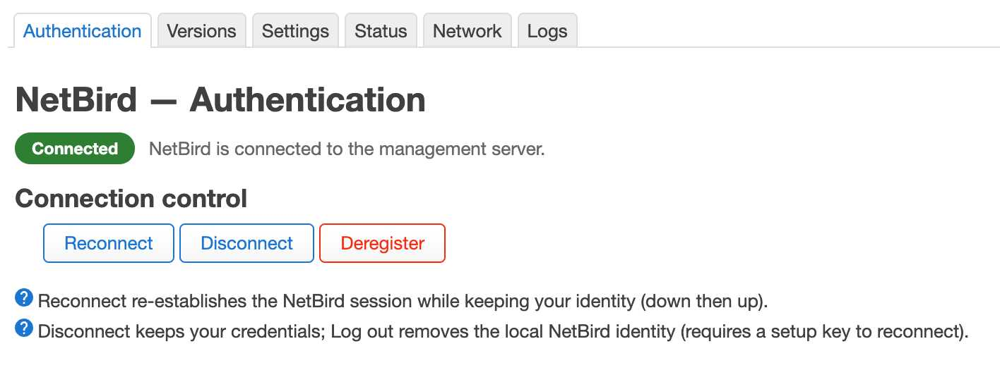
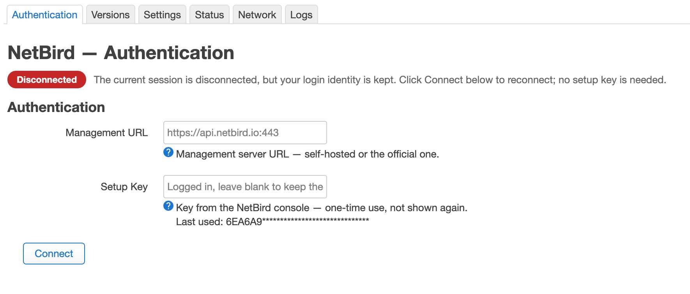

### Versions

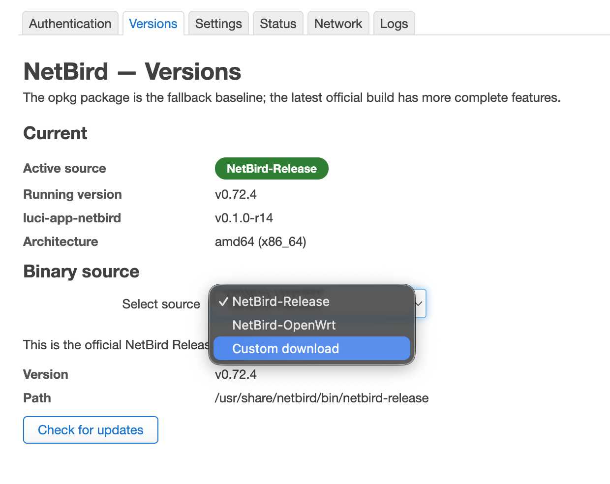

### Settings

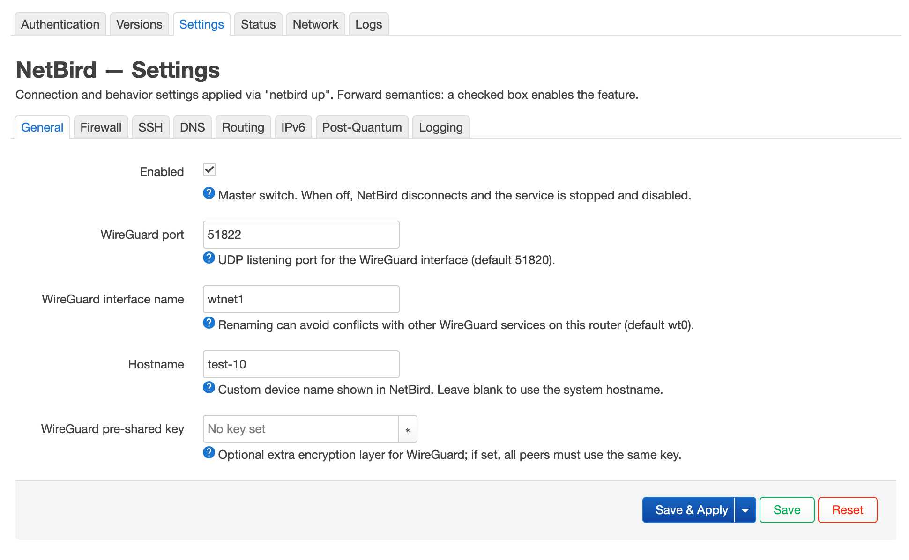
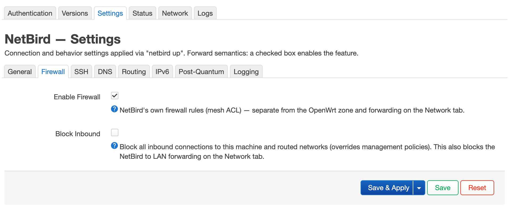
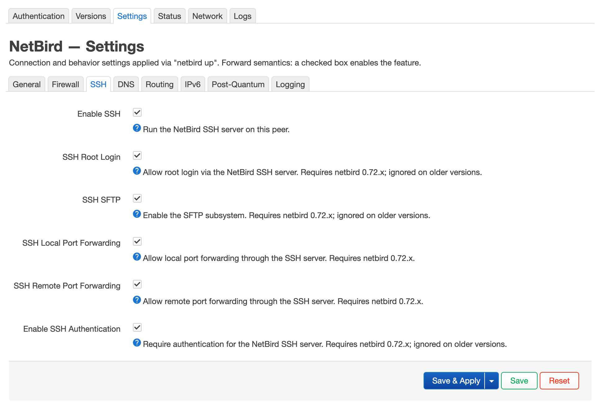
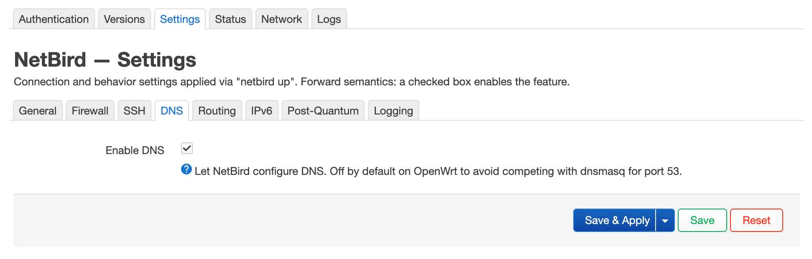
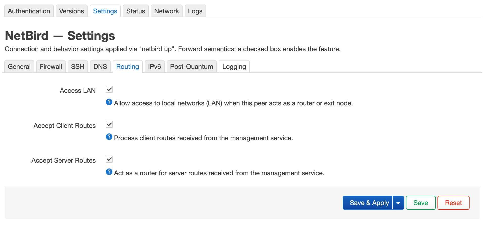
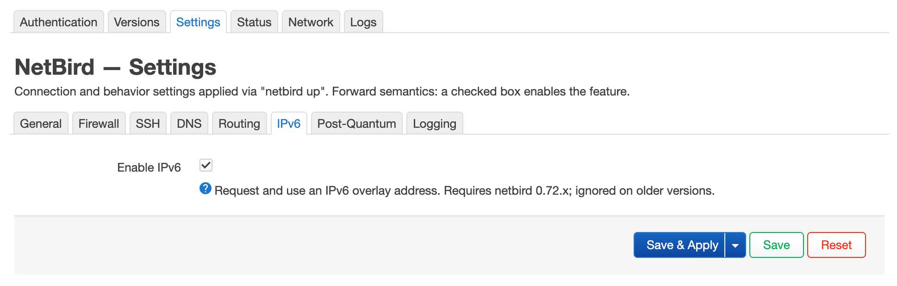

### Status

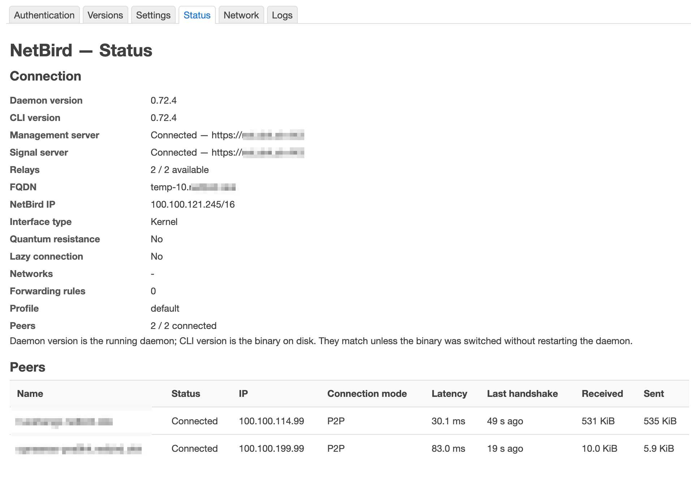

### Network

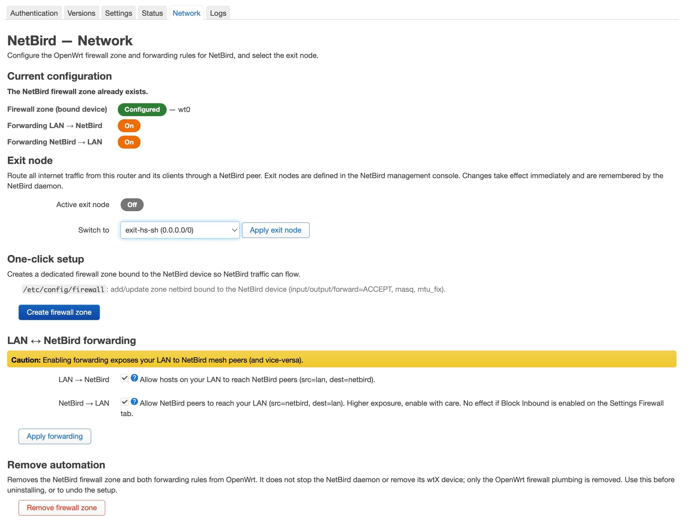

### Logs

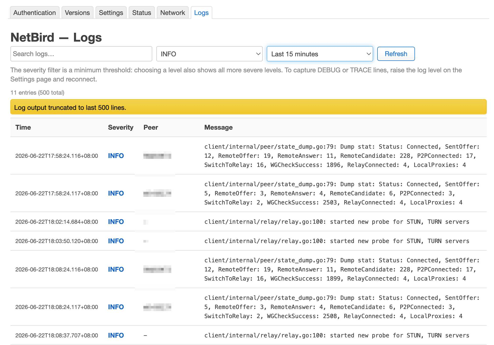
