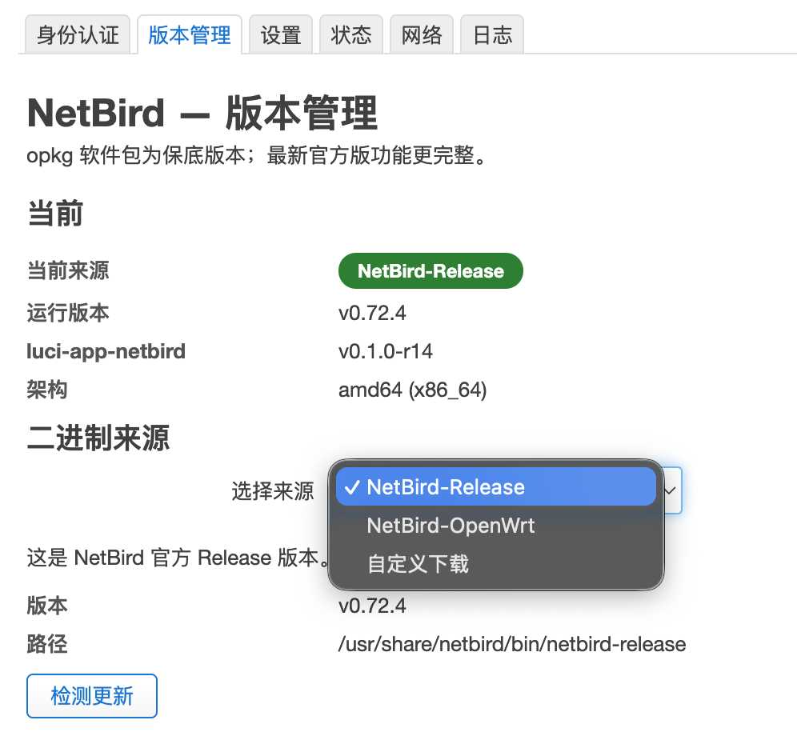
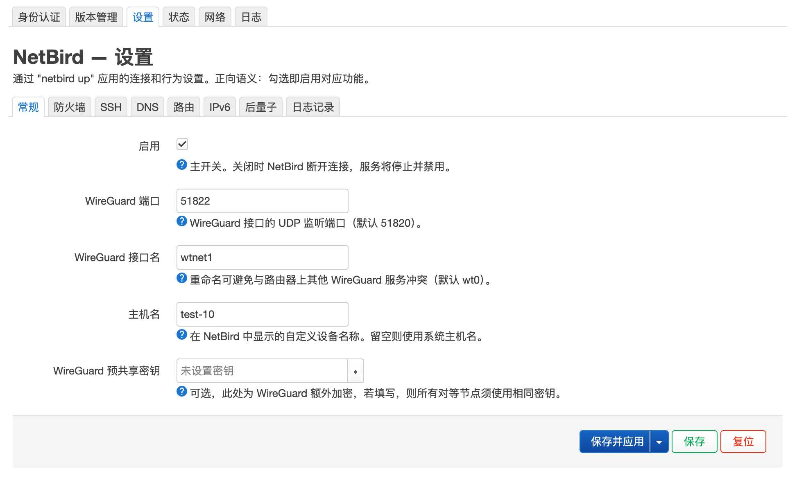
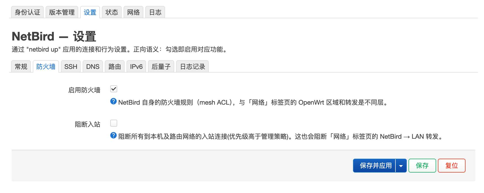
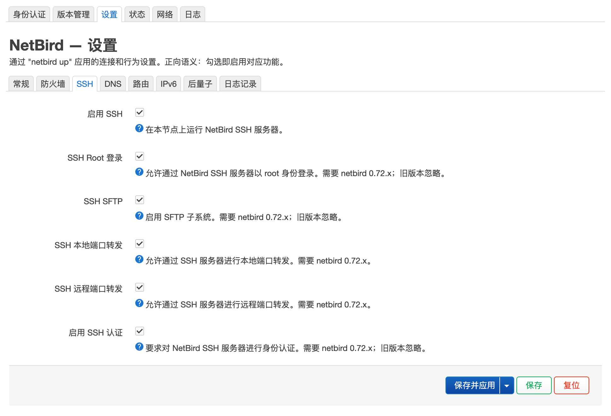
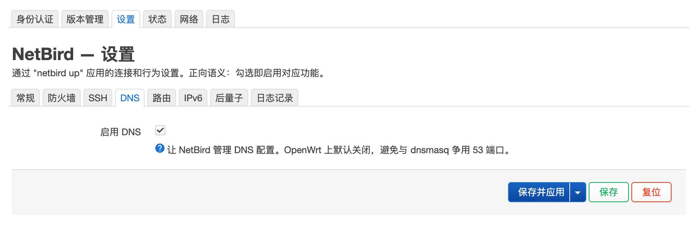
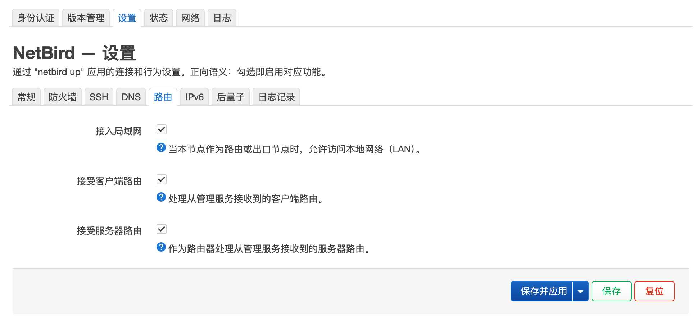
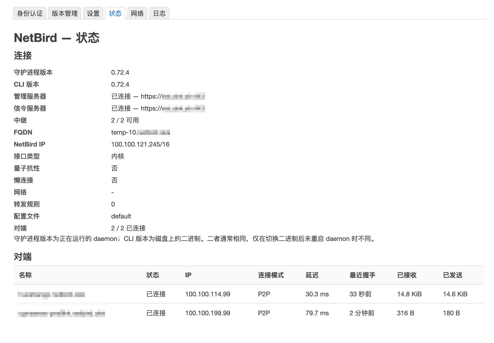
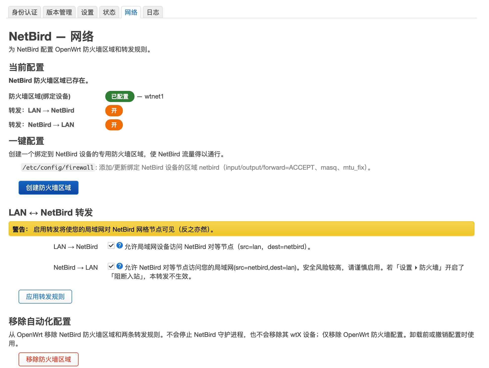
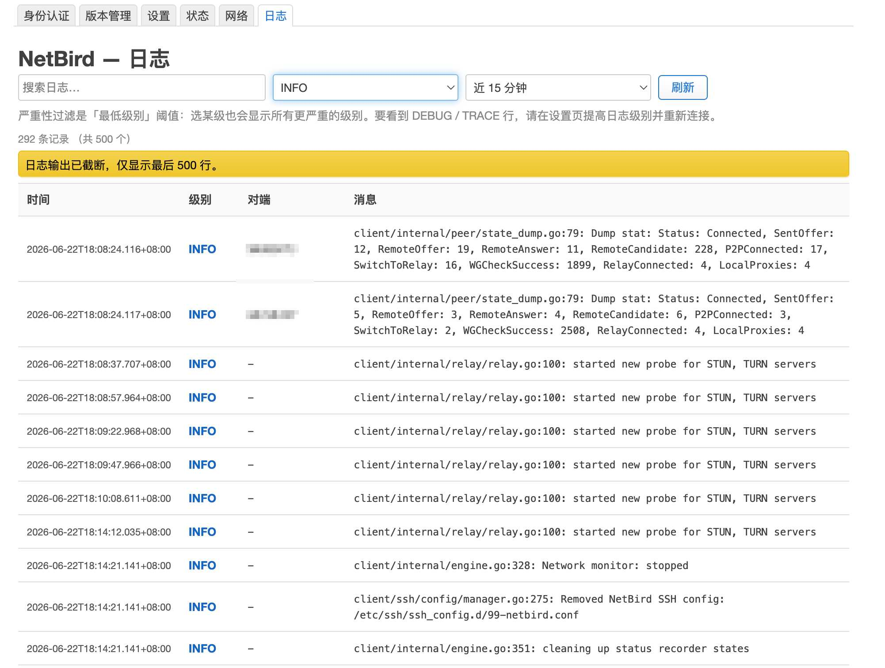

<p align="center">
  
</p>

# luci-app-netbird

[English](README.md) | **简体中文**

**Fork 说明：** 本仓库保留手动安装二进制兼容及 GitHub API/CDN 镜像配置；二进制来源仅提供官方 release 与自定义 URL，不强制依赖系统 `netbird` 软件包。请从[本 fork 的 Releases](https://github.com/InoriHimea/luci-app-netbird/releases) 安装，或从源码构建。下方一键安装源分发的是上游版本，不是本 fork。

> [!NOTE]
> 上游作者说明：项目代码几乎都通过 vibe coding 写成，上游版本发布前会在不同版本的 OpenWrt 上做实机测试，作者有 10 台以上设备运行此应用。本 fork 自己的验证与推广范围以 Release 说明为准。

OpenWrt / ImmortalWrt 上管理 [NetBird](https://netbird.io) mesh-VPN 客户端的 LuCI 应用 —— 在路由器上使用 NetBird，无需命令行。
同时兼容 OpenWrt / ImmortalWrt 22.03 / 23.05 / 24.x（`opkg`）和 25.x / 最新 snapshot（`apk`）。
OpenWrt 21.02 及更早版本无法支持——官方软件源缺少后端运行所需的 `ucode` / `rpcd-mod-ucode`。

## 功能

把 NetBird 客户端的能力接入 LuCI 管理界面：

- 连接 / 重新连接 / 断开 / 注销；支持自托管管理服务器
- 短暂断网后自动重连 —— 认证失败时给出明确原因
- 二进制版本管理 —— 官方 release 或自定义 URL，支持 GitHub API/CDN 镜像配置
- 默认关闭的夜间 agent 自动升级 —— 持久回退、身份保护与连续 5 分钟健康验收
- 防火墙自动化 —— NetBird 区域与 LAN ↔ mesh 转发
- 出口节点选择 —— 全部互联网流量经指定 mesh 节点出口，一键切换或关闭
- 完整 `netbird up` 设置 —— WireGuard、路由、DNS、SSH、IPv6、Rosenpass、日志层级
- 对端状态与实时日志

## 安装

**一键安装** —— 添加签名软件源,然后安装本插件 + 简体中文语言包:

```sh
# 使用 curl:
sh -c "$(curl -fsSL https://luci-app-netbird.okk.sh/install-zh.sh)"
# 没有 curl 的路由器:
wget -O - https://luci-app-netbird.okk.sh/install-zh.sh | sh
```

之后照常管理 —— 命令行 `opkg`/`apk`,或 **LuCI → 系统 → 软件包**。本插件与架构无关(`PKGARCH:=all`);在 **服务 → NetBird** 中访问。

<details><summary><b>只添加软件源(自己再装)</b></summary>

```sh
wget -O - https://luci-app-netbird.okk.sh/feed.sh | sh
opkg install luci-app-netbird luci-i18n-netbird-zh-cn
# 或:  apk add luci-app-netbird luci-i18n-netbird-zh-cn
```
</details>

<details><summary><b>用安装包手动安装</b></summary>

运行依赖（通常已随固件存在）：`rpcd`、`rpcd-mod-ucode`、`ucode`、`ucode-mod-fs`、`ucode-mod-uci`、`luci-base`、`conntrack`。需要已有 NetBird daemon 服务（`/etc/init.d/netbird`）；支持手动安装的二进制，不强制安装系统 `netbird` 软件包。

```sh
# OpenWrt / ImmortalWrt 22.03 / 23.05 / 24.10(opkg)
opkg install rpcd rpcd-mod-ucode ucode ucode-mod-fs ucode-mod-uci luci-base conntrack
opkg install luci-app-netbird_*.ipk luci-i18n-netbird-zh-cn_*.ipk
# OpenWrt / ImmortalWrt 25+(apk)
apk add rpcd rpcd-mod-ucode ucode ucode-mod-fs ucode-mod-uci luci-base conntrack
apk add --allow-untrusted luci-app-netbird-*.apk luci-i18n-netbird-zh-cn-*.apk
```
</details>

<details><summary><b>从源码构建</b></summary>

把本仓库加入 OpenWrt / ImmortalWrt 的 SDK 或 buildroot(`package/` 下或 feed),然后 `make package/luci-app-netbird/compile V=s`。
</details>

**卸载:** `wget -O - https://luci-app-netbird.okk.sh/uninstall.sh | sh`

## 更新范围

- **插件更新**（版本页 `luci-app-netbird` 这一行）安装本 fork 的完整包，包括前端、RPC 后端、设置/watchdog 脚本、安装迁移及包管理器依赖。仅在中文包已安装时一并更新；保留 UCI 设置及 NetBird 身份，不升级独立的 NetBird 客户端二进制。
- **NetBird 二进制更新**是另一项操作。官方版本激活时是 `/usr/bin/netbird` 真文件；custom 使用版本化 symlink。切到 custom 时保存官方版本，切回无需重下；更新停放的官方版本不打断正在运行的 custom daemon。
- 插件更新仍由用户操作触发；agent 另有默认关闭的夜间自动更新计划。自动重连与升级是两项独立操作；首次连接仍可补齐缺失的官方二进制。
- 从 **0.2.0-r4** 起，插件更新读取本 fork GitHub Release 的 `manifest.json`，按确定的版本 tag 下载资产，并使用已配置的 GitHub CDN 地址。**r3 及更早版本须先从本 fork Releases 手动升级一次**，旧入口仍查询上游软件源。
- 从 **0.2.0-r5** 起，安装时会先将历史 `netbird.uc.bak*` 备份归档到私有的 `/root/netbird-rpcd-backup.*` 目录，再由系统原生重载 RPC 后端。手工备份必须放在 `/usr/share/rpcd/ucode/` 之外：rpcd 会加载其中所有普通文件，改成 `.bak` 后缀仍可能让旧后端抢先注册。
- 从 **0.2.0-r6** 起，最新版本由本 fork 的 Release API（`api_base`）查询，清单与包仅从确定 tag 的 CDN 地址下载。若 r4/r5 因镜像缓存仍显示旧版本，先从确定版本的 Release 包引导升级 r6，无须等待镜像缓存刷新。

### Agent 夜间自动更新

在 **版本 → Agent 自动更新** 中配置持久身份目录和经 NetBird 接口可达的 HTTP(S) 服务探针。需安装 `curl`，并启用早期开机恢复与独立监护服务。默认 **北京时间 03:30**（POSIX 写法 `UTC-8`），维护窗口 **03:00–05:00**，仅允许发布满 **48 小时**的官方稳定版。不会修改设备时区；填写 `system` 则使用设备时区。错过任务不在白天补跑，持久日期记录防止时钟回拨后重复执行。

仅健康、已连接且用户仍希望连接的 `release` 来源符合准入。custom、服务关闭、主动断开、外部 watchdog 未对接、已有维护或存储/RAM 不足均不升级。下载必须通过固定版本、官方 SHA-256、完整归档、本机 ELF 与可执行版本校验。计划只保存到 `netbird_bin`，不会因保存计划重连；**不自动升级 LuCI 插件**。

切换前先保存并验证旧二进制，确认旧进程完全退出，再把实际 profile/身份归档到私有持久存储，然后原子替换。新版最多 120 秒恢复连接，并连续健康观察 5 分钟；核对 public key、Mesh IP、管理地址、DNS、进程稳定性和服务探针。独立截止 worker 从停止旧版起执行 10 分钟硬截止。失败会恢复并复验旧版；激活失败版本进入阻止名单，回滚未恢复联网则暂停后续升级，不冒充回滚成功。升级和回滚都存在短暂 Mesh 中断。

如存在 `/root/ztn-watchdog.sh`，必须先显式对接维护保护，才能开启无人值守：

```sh
NB_AGENT_WORKER=1 ucode /usr/share/netbird/agent-update-worker.uc integrate-watchdog
```

该命令私有备份原脚本，再原子前置维护保护，不重写其业务逻辑，也不覆盖自定义 NetBird init。恢复失败时请走本地控制台或独立 SSH 入口，排除故障后，用同一命令前缀依次执行 `recover-retry`、`reset`。**不要删除 `/etc/netbird-update` 或回退副本来消除报错。** 开机恢复无法还原旧文件时，会暂缓 NetBird 的开机注册；修复复验后显式 reset 才恢复注册。

现网错峰计划仍为：56 03:00、55 03:30、上海 04:00、武汉 04:30，均为北京时间；DC 在主机密钥独立核验前排除。首次只启用 56，观察一个维护窗口后再逐台启用。本次实现不向现网写入这些计划。

## 快速上手

1. 在 [NetBird 控制台](https://app.netbird.io)（或你的自托管面板）创建一个**安装密钥（setup key）**。
2. **服务 → NetBird → 认证** —— 自托管请先填「管理 URL」；打开主开关，粘入密钥，点**连接**。
3. *（可选）* **网络**标签页 —— 先「创建防火墙区域」，再按需启用 `LAN → NetBird` / `NetBird → LAN` 转发。

## 文档

- [架构](docs/ARCHITECTURE.md) —— 设计、数据流、模块边界
- [发布](docs/RELEASING.md) —— CI 触发规则、按包版本发布
- [更新日志](CHANGELOG.md) —— 版本历史

## 说明

- 已在 x86_64 验证；其他架构（arm64 / 386 / armv6）支持但测试较少。
- SSH 扩展（Root 登录 / SFTP / 端口转发）需 netbird 0.72.x+。
- 较旧官方源的 netbird 版本偏低——23.05 是 0.24.x，22.03 是 0.17.x：连接 / 状态 / 设置可用，但 exit node 选择需 netbird 0.35+ —— 安装后请在「**版本**」页把二进制切换到最新官方 release。22.03 上尤其建议切换。
- NetBird 需要内核 WireGuard 模块或 TUN 设备。官方 OpenWrt 镜像默认既不带 `kmod-wireguard` 也不带 `kmod-tun`，而 `netbird` 包本身并不依赖它们。概览页与状态页会自动检测并提供**一键安装**按钮替你装好；若固件用的是定制内核、软件源模块不匹配，界面会原样展示包管理器输出，便于自行安装匹配版本。
- `/etc/config/netbird` 是 conffile —— 升级保留你的设置。

## 许可

Apache-2.0 —— 见 [`LICENSE`](LICENSE) 与 [`NOTICE`](NOTICE)。
架构与部分范式参考 [luci-app-tailscale-community](https://github.com/Tokisaki-Galaxy/luci-app-tailscale-community)（Apache-2.0）；UI 思路参考 OPNsense [os-netbird](https://github.com/opnsense/plugins/tree/master/net/os-netbird)（BSD-2-Clause，© NetBird GmbH）。

## 截图

### 认证


### 版本管理



### 设置







### 状态



### 网络



### 日志


